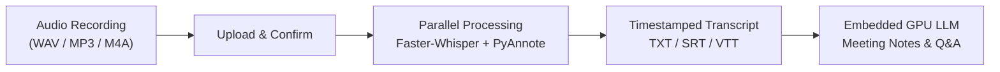

# Local Cantonese Speech-to-Text

A completely offline, local GPU-accelerated Cantonese speech-to-text pipeline featuring:
- **Faster-Whisper (NVIDIA CUDA)**: Fast and accurate Cantonese transcription (`yue` / `zh`).
- **Speaker Diarization (PyAnnote Audio)**: Automatically labels who spoke when (`說話人1`, `說話人2`).
- **Embedded GPU LLM Meeting Assistant (llama-server)**: Direct, in-process local LLM chat and meeting notes generation without needing Ollama or external daemons.
- **Dynamic Model Selection & Auto-Download**: Switch between Weak (1.5B), Medium (3B), and Strong (8B) models with automatic on-demand download to `models/`.
- **Zero-Cloud & 100% Privacy**: All audio processing, transcript generation, and LLM reasoning run locally on your GPU.

---

## Architecture Pipeline

---

## Getting Started

### 1. First-Time Setup (One-Click)
Double-click **`Setup.exe`**.

The installer will automatically set up the self-contained environment in this folder:
- Portable Python 3.11 runtime (~11 MB)
- PyTorch with NVIDIA CUDA cu128 acceleration (~2.3 GB)
- Faster-Whisper, PyAnnote Audio, and web dependencies
- Embedded CUDA-accelerated `llama-server` engine (~180 MB)

*(You only need to run `Setup.exe` once)*

---

### 2. Launch the Application
- Double-click **`CantoneseSTT.exe`**.
- Your browser will open automatically at `http://127.0.0.1:5000`.
- Drop in your audio file, select your preferences, and click **開始轉寫** (Start Transcription).
- Download your finished transcript as **TXT**, **SRT**, or **VTT**.

### 3. Stop the Application
- Double-click **`Stop Cantonese STT.exe`** to cleanly close both the web server and the embedded LLM.

---

## Model Selection

You can select your preferred meeting assistant model directly in the web UI under **LLM 模型**:
- **Weak (`Qwen2.5-1.5B`)**: Ultra-fast response, minimal memory footprint (~1.1 GB).
- **Medium (`Qwen2.5-3B`)**: Balanced speed and detailed summarization (~2.0 GB).
- **Strong (`Qwen3-8B`)**: Flagship reasoning, long context extraction (~4.9 GB).

*If a selected model is not yet in the `models/` directory, the application will automatically download it on demand with live progress.*

---

## Hardware Requirements
- **OS**: Windows 10 / 11 (64-bit)
- **GPU**: NVIDIA GeForce RTX (6GB+ VRAM recommended, tested on RTX 4060 Laptop 8GB)
- **CUDA**: NVIDIA GPU drivers with CUDA 12 support

---

## License
MIT License
